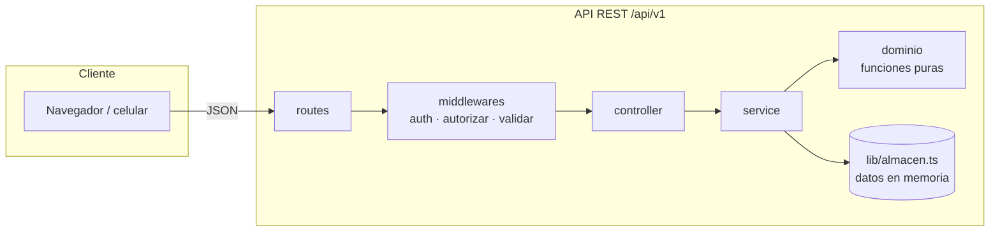

# ARCHITECTURE.md — Préstamo de libros

> Hecho con la plantilla del arnés 0.4.0. Si cambias una capa, cambia este archivo en el mismo commit.

## 1. Vista general



**Regla de dependencias** (la hace cumplir `arnes-ia/stacks/express/.dependency-cruiser.cjs`; el acceso a datos es `lib/almacen`, declarado en `arnes.config.json`): cada capa solo depende de la de su derecha. `dominio/` no depende de nada del framework ni de la BD.

## 2. Estructura de carpetas

```
prestamo-libros/
├── AGENTS.md  CLAUDE.md  ARCHITECTURE.md  README.md
├── arnes.config.json  arnes-ia/
├── docs/  requerimientos.md  PROYECTO.md  bitacora-ia.md  adr/
├── src/
│   ├── app.ts  server.ts
│   ├── config/        variables de entorno, permisos
│   ├── middlewares/   auth, autorizar, validar, errores
│   ├── lib/           almacén en memoria, reloj, paginación, AppError
│   └── modules/<modulo>/
│       ├── <modulo>.routes.ts
│       ├── <modulo>.controller.ts
│       ├── <modulo>.service.ts
│       ├── <modulo>.schemas.ts
│       ├── dominio/   reglas puras (cálculos, validaciones de negocio)
│       └── <modulo>.test.ts
```

Este proyecto no usa base de datos: `src/lib/almacen.ts` guarda los datos en memoria y `src/lib/reloj.ts` da la hora (fijable en las pruebas).

## 3. Módulos

| Módulo | Responsable | Requerimientos | Depende de |
|---|---|---|---|
| `libros` | Santiago Pech | RF-01, RF-02 | — |
| `prestamos` (`dominio/prestamo.ts`) | Santiago Pech | RF-03–RF-06, RN-01–RN-06 | `libros` (vía `librosService`) |

## 4. Decisiones

Ver `docs/adr/`. Cada decisión que cambie esta arquitectura necesita un ADR nuevo.
